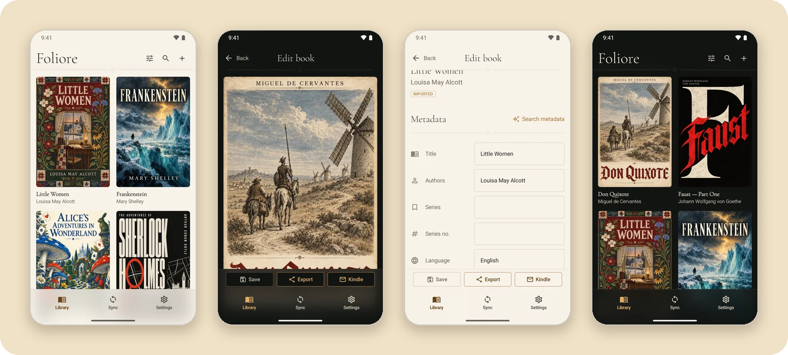

<p align="center">
  
</p>

<h3 align="center">Your ebook library, tidy and ready for any e-reader.</h3>

<p align="center">
  Foliore is a free Android app for people who keep their own EPUBs.<br>
  It brings your books together, fixes titles, authors and covers,<br>
  and sends clean copies to your Kindle or any other e-reader.
</p>

<p align="center">
  <a href="https://github.com/JohanKRS/foliore/releases/latest"></a>
  <a href="LICENSE"></a>
  
  
  
  
</p>

<p align="center">
  <b>English</b> · <a href="README.pt-BR.md">Português</a> · <a href="https://foliore.johankrs.com/en/">Website</a>
</p>

---

## Get Foliore

<p align="center">
  <a href="https://github.com/JohanKRS/foliore/releases/latest"></a>
  <a href="https://apps.obtainium.imranr.dev/redirect?r=obtainium://add/https://github.com/JohanKRS/foliore"></a>
  
</p>

- **Download the APK** from [GitHub Releases](https://github.com/JohanKRS/foliore/releases/latest) and open it on your phone. Android 8.0 or newer. Your phone will ask you to allow installs from your browser or file manager, which is normal for apps from outside the Play Store.
- **Use [Obtainium](https://obtainium.imranr.dev/)** if you'd like updates to arrive on their own. Add Foliore once and Obtainium picks up each new release from GitHub.
- **Google Play** is on the way.

## A quick look

<p align="center">
  
</p>

## What it does

<table>
  <tr>
    <td width="50%" valign="top">
      <h3>📚 Brings your books together</h3>
      Import the EPUBs you already have, or share them to Foliore from any app. DRM-free MOBI and AZW3 files are converted to EPUB right on your phone, and your original files stay untouched.
    </td>
    <td width="50%" valign="top">
      <h3>✏️ Tidies them up</h3>
      Fix titles, authors, series, language, publisher and synopsis, and swap covers. Foliore can look up details and covers for you in open catalogs: Open Library, the Internet Archive and the French National Library.
    </td>
  </tr>
  <tr>
    <td width="50%" valign="top">
      <h3>📤 Sends them where you read</h3>
      Export ready-to-read copies, share them, or send them straight to your Kindle by email, using Gmail or your own mail server.
    </td>
    <td width="50%" valign="top">
      <h3>📖 Lets you read right there</h3>
      A built-in reader with pages, search, bookmarks and adjustable text. Your progress shows on each cover, and the “Recently read” sort keeps your current books up front.
    </td>
  </tr>
  <tr>
    <td width="50%" valign="top">
      <h3>🔄 Follows you across devices</h3>
      Keep everything on your phone, or sync through a private folder in your Google Drive or any folder you choose. It works offline, and changes come together when you're back.
    </td>
    <td width="50%" valign="top">
      <h3>✨ Lends a hand with AI <sub>(optional)</sub></h3>
      Sign in with your ChatGPT account (Plus or Pro) to write synopses, fill in missing details and find a book's real cover. With an OpenAI API key, Foliore can also create a brand-new cover.
    </td>
  </tr>
</table>

And it's yours to style: light and dark themes, four app icons, and eight languages (English, Portuguese, Spanish, French, German, Italian, Japanese and Chinese).

## Free, with no strings attached

- 🚫 **No ads, no purchases, no book limits.** Every feature is there for everyone.
- 🙅 **No account needed.** Google Drive, Gmail, ChatGPT and OpenAI are all optional. Foliore works fine without any of them.
- 🔒 **Your library stays with you.** Your books live on your phone, and they only go to the places you send them, like your own Drive or your Kindle. Read the [privacy policy](https://foliore.johankrs.com/en/privacy/).
- 💚 **Open source.** The code is public under the [GPL-3.0](LICENSE), so anyone can read it, check it and help make it better.

## Good to know

<details>
<summary><b>Does Foliore remove DRM?</b></summary>
<br>
No. It only opens and converts DRM-free files. If a book is protected, Foliore tells you clearly instead of trying to break it.
</details>

<details>
<summary><b>Is it an e-reader app?</b></summary>
<br>
It has a good reader, but its main job is to organize your books and get them ready. Keep reading wherever you like best: in Foliore, on your Kindle or on any other e-reader.
</details>

<details>
<summary><b>How does the ChatGPT sign-in work?</b></summary>
<br>
It uses OpenAI's official <a href="https://developers.openai.com/siwc">Sign in with ChatGPT</a> for open source apps. Requests go straight from your phone to OpenAI and count toward your own ChatGPT plan (Plus or Pro). Your sign-in is encrypted on the device and is only ever sent to OpenAI. Creating new covers isn't available through this sign-in yet, so that still needs an OpenAI API key.
</details>

<details>
<summary><b>Is there an iPhone version?</b></summary>
<br>
Not for now. Foliore is made for Android first.
</details>

<details>
<summary><b>Found a bug or have an idea?</b></summary>
<br>
Please <a href="https://github.com/JohanKRS/foliore/issues">open an issue</a>. Every report helps.
</details>

## For developers

Foliore is written in Kotlin. The core (book model, EPUB parsing and storage) is a Kotlin Multiplatform module with SQLDelight, and the Android app uses Jetpack Compose.

**Build it.** Open this folder in Android Studio and let Gradle sync; the Gradle Wrapper is included. MOBI/AZW3 conversion builds native C code, so also install NDK `28.2.13676358` and CMake `3.22.1` from the SDK Manager. Their sources are vendored, so the build doesn't fetch code from GitHub. iOS targets only turn on when the project is opened on macOS.

Play Store bundles (`bundleRelease`) only build after the publication checks are confirmed: copy `publication.properties.example` to `publication.properties` and set each item once it's verified.

**Run the tests.**

```sh
./gradlew :androidApp:testDebugUnitTest
```

**Find your way around.**

```text
shared/      Kotlin Multiplatform core: models, EPUB parser, SQLDelight schema, repository
androidApp/  Android app: Compose UI, file import, storage, sync, reader
iosApp/      Placeholder for a future iOS app
support/     Small service that receives content reports
docs/        Product and implementation notes
artwork/     App icon, store graphics and the images in this README
```

**Read more.**

- [Built-in reader](docs/READER.md) · [Format conversion](docs/FORMAT_CONVERSION.md) · [Sync protocol](docs/SYNC_SPEC.md) · [Gmail delivery](docs/GMAIL.md)
- [Changelog](CHANGELOG.md) · [How releases are made](docs/RELEASING.md) · [Reporting service](support/README.md)

<details>
<summary><b>Technical notes on Sign in with ChatGPT</b></summary>
<br>
The connection follows OpenAI's program for open source projects: OAuth 2.0 with PKCE, a dynamically registered client and a loopback redirect that the app serves on <code>127.0.0.1</code> while the browser sign-in is open. Requests go to the OpenAI Responses API. Tokens are encrypted with the Android Keystore. Image generation through this connection is ready in the code but turned off behind <code>AiFeatureFlags.CHATGPT_IMAGE_GENERATION</code> until OpenAI supports it.
</details>

## License

Foliore is free software under the [GNU General Public License v3.0](LICENSE). Third-party components keep their own licenses; see the [third-party notices](third-party/README.md).

<p align="center">
  <br>
  <br>
  <sub>Happy reading! 📚</sub>
</p>
