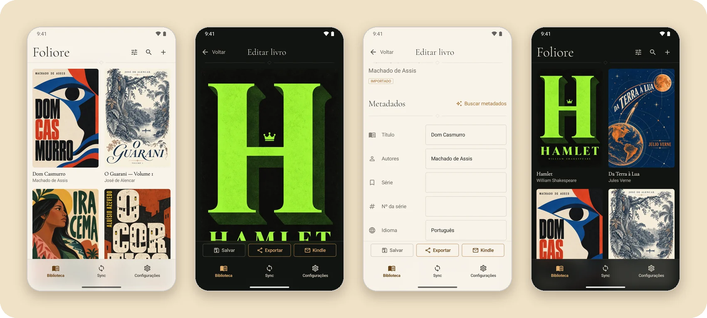

  

<h3 align="center">Sua biblioteca de ebooks, organizada e pronta para qualquer leitor.</h3>

  O Foliore é um app gratuito para Android, feito para quem guarda os próprios EPUBs. 
  Ele junta seus livros, acerta títulos, autores e capas, 
  e manda cópias caprichadas para o seu Kindle ou qualquer outro leitor digital.

  
  
  
  
  
  

  <a href="README.md">English</a> · <b>Português</b> · <a href="https://foliore.johankrs.com/">Site</a>

---

## Baixe o Foliore

  
  
  

- **Baixe o APK** no [GitHub Releases](https://github.com/JohanKRS/foliore/releases/latest) e abra no celular. Precisa do Android 8.0 ou mais recente. O celular vai pedir para liberar a instalação pelo navegador ou pelo gerenciador de arquivos, o que é normal para apps de fora da Play Store.
- **Use o [Obtainium](https://obtainium.imranr.dev/)** se quiser receber as atualizações sozinho. É só adicionar o Foliore uma vez, e o Obtainium pega cada versão nova no GitHub.
- **Google Play**: em breve.

## Uma espiada

  

## O que ele faz

<table>
  <tr>
    <td width="50%" valign="top">
      <h3>📚 Junta seus livros</h3>
      Importe os EPUBs que você já tem, ou compartilhe com o Foliore a partir de qualquer app. Arquivos MOBI e AZW3 sem DRM viram EPUB no próprio celular, e os originais ficam intactos.
    </td>
    <td width="50%" valign="top">
      <h3>✏️ Deixa tudo nos trinques</h3>
      Corrija título, autores, série, idioma, editora e sinopse, e troque a capa. O Foliore busca dados e capas para você em catálogos abertos: Open Library, Internet Archive e a Biblioteca Nacional da França.
    </td>
  </tr>
  <tr>
    <td width="50%" valign="top">
      <h3>📤 Manda para onde você lê</h3>
      Exporte cópias prontas para ler, compartilhe, ou envie direto para o seu Kindle por e-mail, pelo Gmail ou pelo seu próprio servidor de e-mail.
    </td>
    <td width="50%" valign="top">
      <h3>📖 Deixa você ler ali mesmo</h3>
      Um leitor embutido com páginas, busca, marcadores e texto ajustável. O progresso aparece em cada capa, e a ordem “Lidos recentemente” deixa os livros do momento na frente.
    </td>
  </tr>
  <tr>
    <td width="50%" valign="top">
      <h3>🔄 Vai com você entre aparelhos</h3>
      Guarde tudo no celular, ou sincronize por uma pasta privada no seu Google Drive ou por qualquer pasta que você escolher. Funciona offline, e as mudanças se juntam quando você volta.
    </td>
    <td width="50%" valign="top">
      <h3>✨ Dá uma mãozinha com IA (opcional)</h3>
      Entre com sua conta do ChatGPT (Plus ou Pro) para escrever sinopses, completar dados que faltam e encontrar a capa de verdade de um livro. Com uma chave de API da OpenAI, o Foliore também cria uma capa nova.
    </td>
  </tr>
</table>

E fica do seu jeito: temas claro e escuro, quatro ícones de app e oito idiomas (português, inglês, espanhol, francês, alemão, italiano, japonês e chinês).

## Gratuito, sem pegadinha

- 🚫 **Sem anúncios, sem compras, sem limite de livros.** Todas as funções estão liberadas para todo mundo.
- 🙅 **Não precisa de conta.** Google Drive, Gmail, ChatGPT e OpenAI são todos opcionais. O Foliore funciona muito bem sem nenhum deles.
- 🔒 **Sua biblioteca fica com você.** Os livros moram no seu celular e só vão para onde você mandar, como o seu Drive ou o seu Kindle. Leia a [política de privacidade](https://foliore.johankrs.com/privacy/).
- 💚 **Código aberto.** O código é público sob a [GPL-3.0](LICENSE): qualquer pessoa pode ler, conferir e ajudar a melhorar.

## Bom saber

<b>O Foliore tira o DRM dos livros?</b>

 
Não. Ele só abre e converte arquivos sem DRM. Se um livro for protegido, o Foliore avisa com clareza em vez de tentar quebrar a proteção.

<b>É um app de leitura?</b>

 
Ele tem um bom leitor, mas o trabalho principal é organizar seus livros e deixá-los prontos. Continue lendo onde você preferir: no Foliore, no Kindle ou em qualquer outro leitor digital.

<b>Como funciona o login com o ChatGPT?</b>

 
Ele usa o <a href="https://developers.openai.com/siwc">Sign in with ChatGPT</a>, o login oficial da OpenAI para apps de código aberto. Os pedidos vão direto do seu celular para a OpenAI e contam no seu próprio plano do ChatGPT (Plus ou Pro). O login fica criptografado no aparelho e só é enviado para a OpenAI. Criar capas novas ainda não funciona por esse login, então isso continua precisando de uma chave de API da OpenAI.

<b>Tem versão para iPhone?</b>

 
Por enquanto, não. O Foliore é feito primeiro para Android.

<b>Achou um problema ou tem uma ideia?</b>

 
<a href="https://github.com/JohanKRS/foliore/issues">Abra uma issue</a>. Toda sugestão ajuda.

## Para desenvolvedores

As instruções de build, os testes, a organização das pastas e a documentação técnica estão na [versão em inglês](README.md#for-developers).

## Licença

O Foliore é software livre sob a [GNU General Public License v3.0](LICENSE). Componentes de terceiros mantêm as próprias licenças; veja os [avisos de terceiros](third-party/README.md).

   
   
  Boas leituras! 📚

