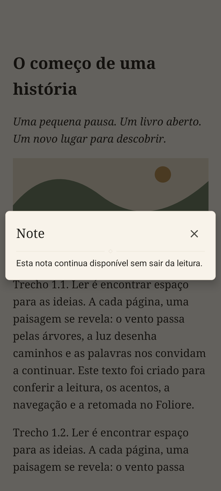
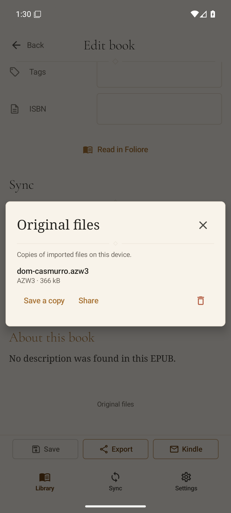
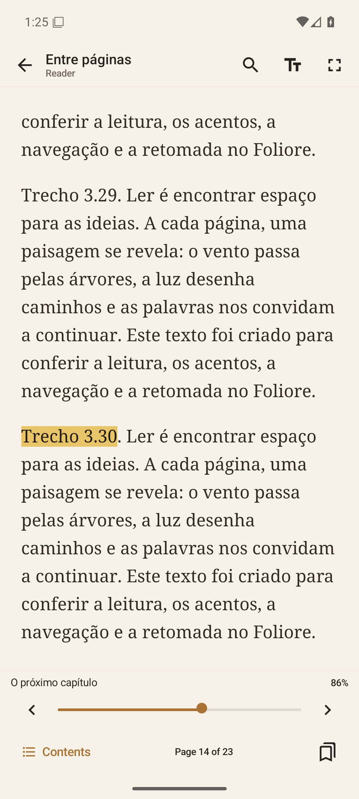
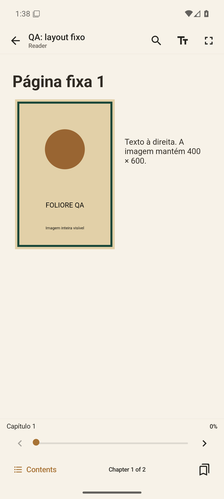
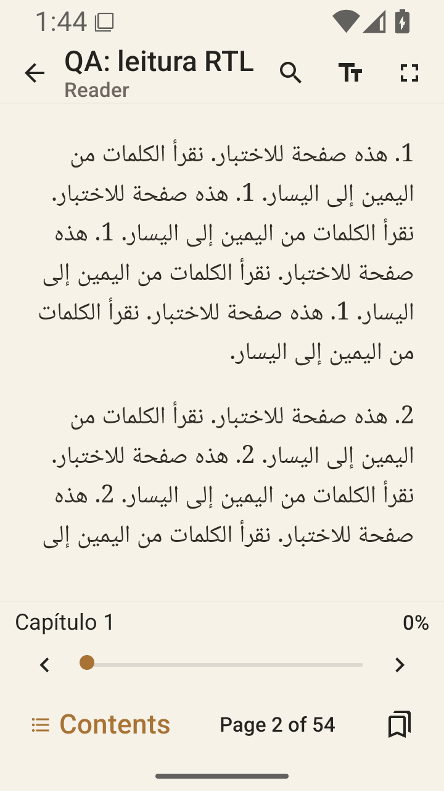
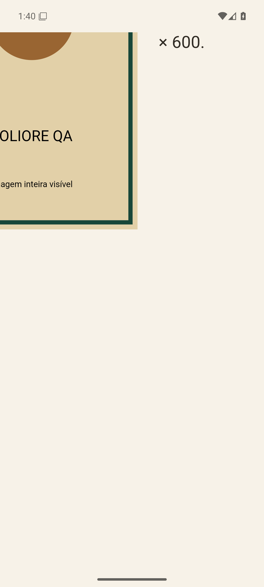
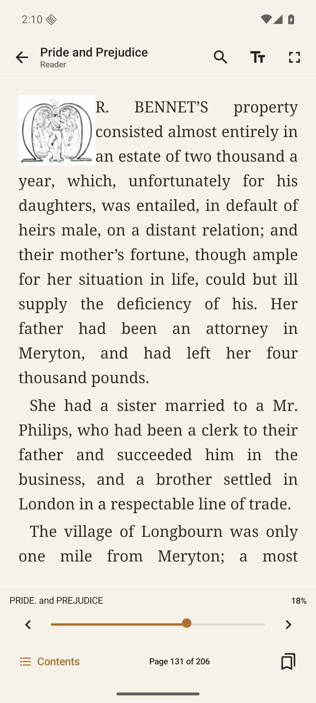

# Conversão, leitor e sincronização — 18/09/2026

Foram testadas 22 entradas, 44 EPUBs resultantes (arquivo da biblioteca e arquivo preparado), 362 combinações de renderização e duas instalações Android independentes. A rodada encontrou e corrigiu problemas reais de conversão, apresentação, retomada e sincronização. Não houve perda de conteúdo ou capas nos testes finais de transferência.

## Correções

- A primeira abertura de livros com imagens grandes podia medir a largura do documento antes de estabilizar a tela e cortar o conteúdo. O runtime agora mede uma área fixa de leitura.
- Contêineres com largura fixa podiam fazer ilustrações ultrapassarem a página. Imagens e contêineres de texto corrido respeitam a área disponível; tabelas largas têm rolagem própria. Arrastar uma tabela não vira a página. O layout fixo conserva as dimensões das imagens.
- Letras iniciais ilustradas com margem negativa podiam ser divididas entre duas páginas. Essas imagens, inclusive quando acompanhadas de aspas, permanecem inteiras no modo paginado; a margem original permanece no modo de rolagem.
- A localização de texto considerava trechos escondidos pela rolagem interna das tabelas. A seleção do trecho agora considera essa área de recorte.
- A rotação podia deslocar progressivamente o ponto de leitura. A referência ao trecho permanece estável durante a recriação da tela e a repaginação; eventos de redimensionamento não são gravados como leitura do usuário.
- Capítulos em árabe eram tratados como uma única página porque a área de rolagem herdava a direção RTL. As coordenadas da paginação permanecem LTR; o texto e os gestos conservam a direção do livro. O teste manual final avançou da página 1 para a 2 de um capítulo com 54 páginas, em tela pequena.
- A preparação eliminava IDs de autores e deixava metadados dependentes sem referência. Também inseria metadados EPUB 3 em EPUB 2 e gravava a data de modificação com frações de segundo. A edição preserva IDs e referências válidas, remove dependências de elementos excluídos e respeita a versão e o namespace do EPUB, inclusive em pacotes XML com prefixo explícito.
- A conversão empacotava HTML moderno de AZW3 como EPUB 2 e mantinha marcação antiga incompatível nos MOBI. Os resultados agora usam EPUB 3, XHTML normalizado e navegação derivada do NCX. Dimensões de imagens, caracteres, links e hierarquia do sumário são preservados. Referências obsoletas a ícones e valores de `playOrder` inconsistentes foram corrigidos. A conversão continua determinística e offline.
- O provedor de documentos do Android acrescentava `.txt` aos marcadores de publicação com nome `.json`. O armazenamento mantém os nomes esperados e o diário consegue ler marcadores antigos com o sufixo adicional, validando seu checksum.
- Uma publicação concluída remotamente, mas sem confirmação local, podia gerar cópias de conflito na tentativa seguinte. A sincronização reconhece a versão exata já publicada. Uma regressão com falha injetada depois da gravação confirma que a repetição mantém um único livro.
- Configurações da janela do leitor deixaram de ser reaplicadas a cada atualização de progresso. Elas são atualizadas quando aparência, brilho, tela cheia ou permanência da tela mudam. Não foi medida uma melhora de quadros atribuível isoladamente a essa alteração.

## Amostras

Os 12 downloads foram feitos com intervalo entre solicitações, sem varrer o catálogo. Os livros permanecem nos artefatos locais, fora do Git. [sources.json](sources.json) registra links, tamanhos e SHA-256.

| Livro | Fonte | Formatos baixados |
| --- | --- | --- |
| Alice's Adventures in Wonderland | [Project Gutenberg #11](https://www.gutenberg.org/ebooks/11) | EPUB 3, AZW3, MOBI |
| Dom Casmurro | [Project Gutenberg #55752](https://www.gutenberg.org/ebooks/55752) | EPUB 3, AZW3, MOBI |
| Pride and Prejudice, ilustrado | [Project Gutenberg #1342](https://www.gutenberg.org/ebooks/1342) | EPUB 2, EPUB 3, AZW3; até 25,3 MB |
| On the Origin of Species | [Project Gutenberg #1228](https://www.gutenberg.org/ebooks/1228) | EPUB 3 |
| 三國志演義 | [Project Gutenberg #23950](https://www.gutenberg.org/ebooks/23950) | EPUB 3, AZW3 |

As outras dez entradas são amostras de regressão: EPUB, MOBI antigo, AZW3 e MOBI híbrido; um livro com busca, marcadores, links e nota; imagens e tabela de 40 × 8 células com largura de 1.800 px; duas páginas fixas; texto árabe; um capítulo com quase um milhão de caracteres; fonte TrueType ofuscada pelo método IDPF, acentos, ruby e texto CJK.

## Resultados funcionais

- **22/22 entradas:** importação, conversão quando necessária, preparo, capas decodificáveis, abertura de todos os documentos do spine, arquivos originais intactos, reconhecimento de duplicatas e limpeza dos temporários. [Resultados](corpus-results.json).
- **44 EPUBs:** nenhuma referência quebrada a recursos locais ou fragmentos no verificador estrutural. As quatro comparações AZW3/EPUB do Gutenberg preservaram 100% da contagem de palavras normalizadas; os dois MOBI preservaram 99,84% e 99,73%. As edições de origem diferem em marcação/apresentação; essa comparação não é prova de identidade editorial.
- **EPUBCheck 5.4.0:** nove entradas Kindle, tanto convertidas quanto preparadas, sem erros. Dom Casmurro AZW3 conserva um aviso sobre ordem de navegação. Os EPUBs 3 baixados do Gutenberg já contêm erros de validação, principalmente atributos ARIA; a preparação não acrescentou erros. O EPUB 2 ilustrado e todas as novas amostras próprias passaram. A amostra EPUB preexistente do conversor conserva dois erros da origem. [Resumo](epubcheck-summary.json).
- **362 verificações em 62 seções de 12 livros:** páginas/rolagem, papel/escuro/claro, texto de 12/20/36 px, margens de 8/24/64 px, formatação do livro ou do leitor. Nenhuma imagem quebrada ou dividida entre páginas; as dimensões de 400 × 600 da página fixa foram confirmadas separadamente. A fonte ofuscada carregou em todos os seis cenários. [Matriz](rendering-summary.json), [regressão RTL](rtl-pagination.json).
- **Interface real:** importação MOBI pelo seletor de documentos; AZW3 pelo compartilhador Android, com destino Foliore e duplicata reconhecida; abertura pelos detalhes; sumário; link entre capítulos; nota em popup; busca, destaque e limpeza; criação, restauração e exclusão de marcador; gestos e tela cheia; páginas/rolagem; tema e fonte; retrato/paisagem; tela de 720 × 1280 com fonte do sistema em 150%; tablet de 1600 × 2560; zoom por pinça e rolagem em página fixa.
- **Retomada:** três ciclos de rotação conservaram exatamente o estado salvo. As aberturas repetidas conservaram o capítulo. [Regressão de rotação](rotation-regression.json).
- **Originais:** popup exibiu AZW3, tamanho e ações; a cópia exportada pelo seletor Android teve SHA-256 idêntico à origem. A exclusão removeu o original arquivado e o leitor continuou abrindo o EPUB convertido. [Cópia](original-copy.txt).
- **Janela:** brilho manual de 50% e `KEEP_SCREEN_ON` observados no leitor; ambos ausentes na janela principal após sair.

As verificações estruturais sozinhas não detectaram a falha RTL. A rodada manual a encontrou; a matriz foi então complementada com uma condição que exige paginação em capítulos longos. Os resultados consolidados incluem a repetição de 84 cenários após a correção RTL e de 86 cenários após o ajuste das iniciais ilustradas. Antes deste último ajuste, 61 ocorrências de imagens fragmentadas apareciam na matriz; depois, nenhuma.

## Sincronização

Duas instalações API 36, com bancos e armazenamento independentes, usaram a seleção real de pasta pelo Android. A pasta publicada foi replicada com ADB entre os emuladores; cada lado leu e escreveu pelo armazenamento SAF de produção. Isso testa o protocolo e o provedor local, sem simular uma autenticação no Google Drive.

- Doze livros recebidos, seis capas byte a byte iguais, mesmos IDs, títulos e hashes dos EPUBs. Inclui importações de MOBI, AZW3 e EPUB. [Conferência](sync-content.txt).
- Posição e marcador transferidos de A para B; abertura no capítulo recebido; recuo deliberado e exclusão do marcador em B transferidos de volta a A. Os dois últimos ciclos transferiram **zero arquivos de livro**. Preferências visuais permanecem locais. [Estado](reading-roundtrip.json), [resultados](sync-results.json).
- Após preparar e abrir todos os livros nos dois lados, a biblioteca convergiu novamente com 12 livros e zero conflitos. Os ciclos finais sem alterações transferiram zero arquivos nos dois emuladores.
- O harness isolado passou com publicação interrompida, confirmação perdida, repetição, mudanças concorrentes, preservação de conflitos legítimos, exclusão concorrente, recuperação, retenção, download corrompido, corrupção local e edição durante o envio. Os arquivos arquivados de origem não fazem parte do backup; a sincronização usa o EPUB da biblioteca e os dados preparados.

## Desempenho

As medições usam APK debug, Android 16/API 36 x86_64, 2 GB de RAM e dois núcleos virtuais. Não representam uma medição de release em telefone. [Dados e limites](performance.json).

- Livro ilustrado de 24,8 MB, já preparado: primeira abertura com processo frio observada em **1.086 ms**; outras 19 aberturas com mediana de **431 ms**, intervalo de **390–630 ms**. Inclui despacho ADB e observação do WebView pronto.
- Importação/conversão do AZW3 ilustrado de 25,3 MB: **1.648 ms**; preparação: **1.328 ms**. O preparo do EPUB ilustrado chegou a **2.208 ms** nessa execução. São amostras individuais do harness Android, não percentis.
- Vinte ciclos de abrir/fechar: PSS após o aquecimento entre aproximadamente **211–225 MiB**. Após coleta de lixo solicitada para inspeção, restaram **uma Activity e zero WebViews**, correspondentes à biblioteca. Isso não substitui uma análise completa de vazamentos. O heap e as medições brutas foram preservados localmente.
- Cinquenta viradas em um capítulo longo: na renderização por software, mediana **48 ms**, P95 **65 ms**; após ativar a GPU do host, mediana **16 ms**, P95 **32 ms**, em 100 quadros. O contador atual ainda marcou **54/100 quadros fora do prazo**; o contador legado marcou 12/100. Não se considera a fluidez aprovada apenas com esses resultados.
- Perfetto mostrou trabalho de recomposição e desenho da interface; o Simpleperf registrou **2.293 amostras, sem perdas**, durante 14,9 s. Renderização/integração gráfica e execução interpretada do build debug ocupam parte relevante da captura. A captura CPU cobre o processo do app; o renderer separado do WebView não está integralmente incluído.

## Verificação e reprodução

**165 testes Android + 10 testes compartilhados + 17 testes JavaScript passaram**, sem testes ignorados. Lint sem erros (136 avisos e cinco sugestões) e `assembleRelease` concluídos. [Contagens](tests.json).

```sh
ANDROID_HOME=/caminho/do/sdk ./gradlew \
  :shared:allTests :androidApp:testDebugUnitTest :androidApp:lintDebug :androidApp:assembleRelease \
  -PconversionNativeLibraryDir=/caminho/do/build/nativo/host
node --test scripts/test_reader_gestures.mjs
python3 scripts/generate_reader_fixture.py /tmp/reader-features.epub
python3 scripts/generate_reader_stress_fixtures.py /tmp/reader-corpus /caminho/DejaVuSerif.ttf
```

O `ReaderCorpusHarness` está apenas nos builds debug/QA. Copie os arquivos para `files/reader-corpus` no armazenamento privado da instalação de teste e invoque:

```sh
adb -s SERIAL shell am broadcast \
  -n com.foliore.android/.debug.DebugImportReceiver \
  -a com.foliore.android.DEBUG_IMPORT_EPUBS --ez corpusTest true
```

O resultado fica em `cache/reader-corpus/result.json`, junto aos arquivos convertidos e preparados de cada entrada. O harness usa bancos e diretórios descartáveis, separados da biblioteca. A regressão de sincronização é acionada pelo `DebugSyncReceiver` com `--ez isolatedSafetyTest true` e grava `cache/sync-safety-result.txt`.

As capturas completas, XML da interface, logs, validações EPUBCheck, Perfetto, Simpleperf e heap estão em `.codex-artifacts/release-qa/`. Os emuladores usados foram criados exclusivamente para esta rodada.

## Limites antes da distribuição

Ainda é necessário conferir fluidez e memória com o APK de distribuição em aparelhos físicos, incluindo um modelo mais simples; sincronização autenticada no Google Drive, com rede real; e envio/abertura em Kindle/Kobo ou outro leitor de destino. Não foram testadas todas as versões do Android suportadas. Paginação idêntica entre WebView e leitores externos não é garantida. Os testes de DRM verificam rejeição, não remoção de proteção.

## Capturas

| Leitura e busca | Originais e layout fixo |
| --- | --- |
|  |  |
|  |  |
|  |  |


