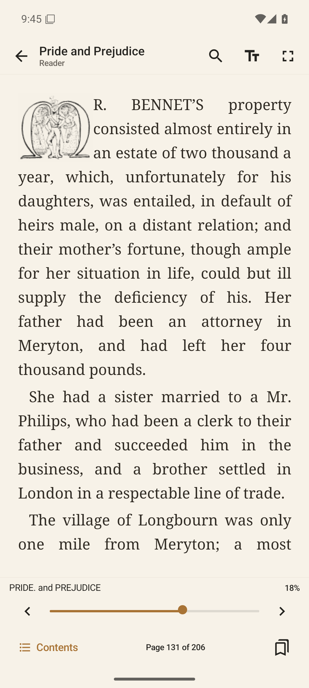
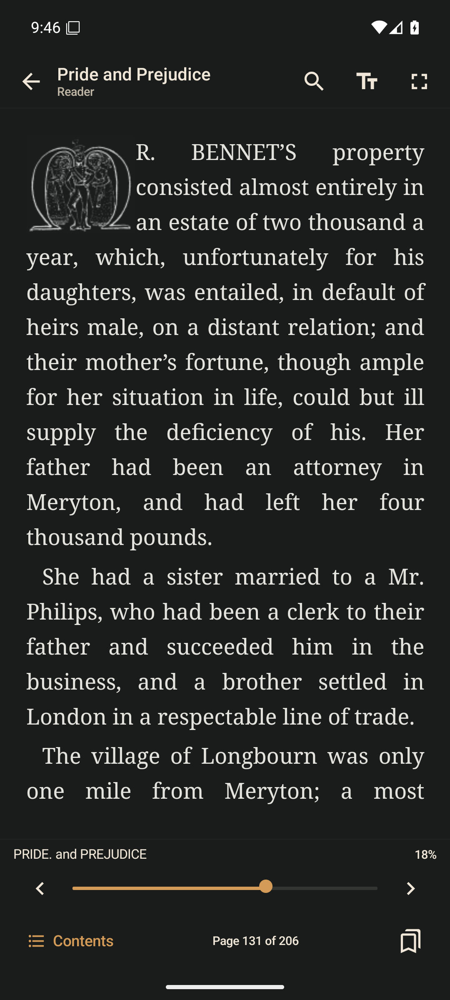
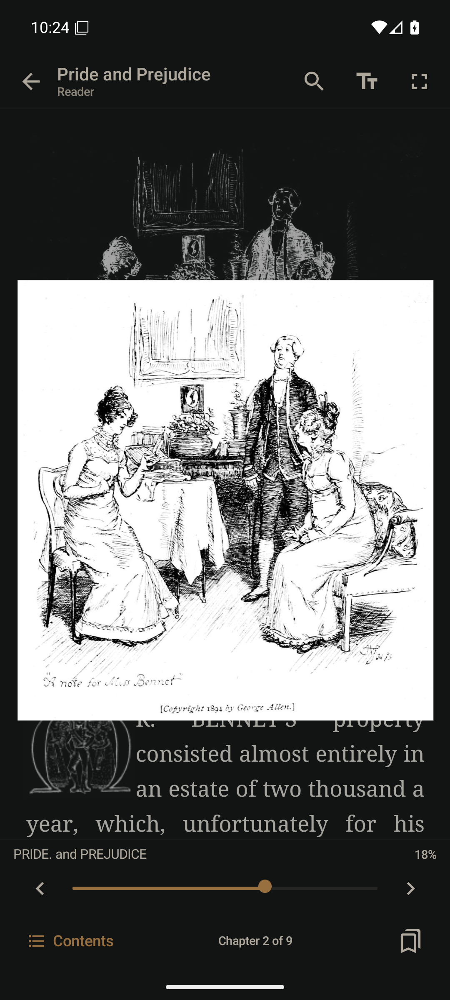

# Ilustrações e visualização original — 18/09/2026

Gravuras monocromáticas com margens claras se integram ao papel; no tema escuro, os traços ficam claros. A detecção é conservadora, ignora capas declaradas e pode ser desligada nas opções do leitor. Os arquivos do livro permanecem intactos.

Ao tocar, a imagem original abre sobre um fundo escurecido em 28%, sem moldura, título ou botões. Pinça amplia até 8×; toque duplo alterna entre ajuste e 2,5×; arrasto percorre a imagem ampliada. Deslize vertical no ajuste inicial, toque fora da imagem e Voltar fecham a visualização.

## Verificação

- Android 16/API 36, WebView real, emulador isolado com aceleração gráfica. Livro: EPUB ilustrado de *Pride and Prejudice* do Project Gutenberg, usado na auditoria anterior.
- Conferidas a inicial ornamental e a gravura mostradas pelo usuário, nos temas papel e escuro, com páginas e rolagem. Desligar a adaptação restaura a imagem e persiste ao reabrir o app.
- Toque abre JPEG e PNG originais sem filtros. Pinça, deslocamento, toque duplo e fechamento por deslize conferidos com eventos reais de toque. Voltar e rotação também conferidos; a imagem permanece aberta após recriação da Activity.
- Abrir/fechar sem rotação preservou exatamente progresso, deslocamento de texto e trecho, tanto em rolagem quanto na página 131/206. Ao girar, o leitor mantém a passagem de texto e recalcula o layout.
- 169 testes Android e 34 testes JavaScript passaram. Builds debug/release e lint passaram. Sem falhas no buffer de crashes durante a conferência.
- Em 20 imagens reais, a amostragem e classificação no WebView teve mediana de 4,5 ms e máximo de 6,6 ms nesta máquina. São medidas do classificador em emulador, não uma medição de desempenho de aparelhos físicos. Amostras têm até 96 × 96 pixels, são processadas uma por vez em períodos ociosos e usam cache limitado.

Os testes automatizados incluem proteção de capas, imagens coloridas/ambíguas, GIFs, recursos repetidos e com falha, imagens locais/data/SVG referenciado, rejeição de URLs remotas, conflitos entre gestos de imagem e leitura, limites do zoom e cancelamento de gestos. A detecção não pretende identificar perfeitamente toda ilustração; a opção de desligar e a visualização original permitem conferir casos ambíguos.

## Capturas

| Papel | Escuro | Original sobre o leitor |
| --- | --- | --- |
|  |  |  |

Logs e medições detalhadas desta execução ficam localmente em `.codex-artifacts/image-tones/`.
